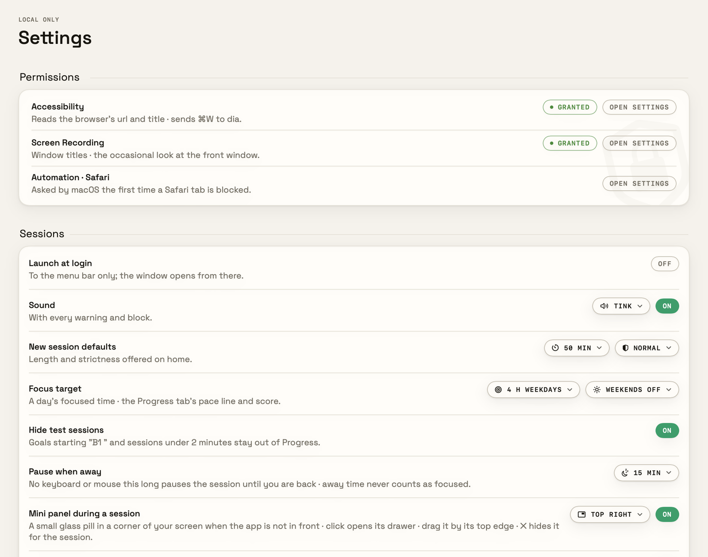
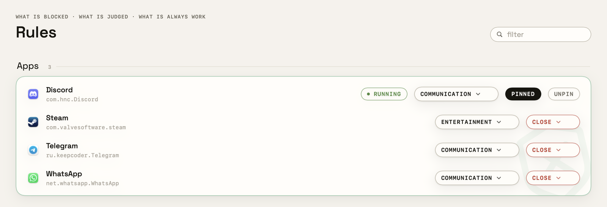

# Installing Distraction Bot

From "I have a Mac" to "a session is running and the judge is ready", about 15 minutes plus the model download.

- [Requirements](#requirements)
- [A · Download the app](#a--download-the-app) (recommended)
- [B · Build from source](#b--build-from-source)
- [The judge: Ollama and a model](#the-judge-ollama-and-a-model)
- [First run](#first-run)
- [Your class calendar (optional)](#your-class-calendar-optional)
- [Updating](#updating) · [Uninstalling](#uninstalling) · [Troubleshooting](#troubleshooting)

## Requirements

| | |
|---|---|
| macOS | **15 Sequoia or later** |
| Mac | **Apple silicon** (M1 or later) for the download. Intel can build from source, but the local models run slowly |
| Memory → judge model | **32 GB or more** → `qwen3:14b` (9.3 GB, most accurate) · **16 GB** → `qwen3:8b` (5.2 GB) · **8 GB** → `qwen3:4b` (2.6 GB, slower and rougher) |
| Disk | about 5–13 GB for the models, plus 20 MB for the app |
| Optional | Ollama for the judge; without it the block list still works |

## A · Download the app

1. On the [Releases](../../releases) page, download **`Distraction-Bot-<version>.zip`**. To check it, compare `shasum -a 256 ~/Downloads/Distraction-Bot-*.zip` with the release's `SHA256SUMS`.
2. Double-click the zip, then drag **Distraction Bot** into your **Applications** folder. It has to live there: launch at login and hard mode look for it at `/Applications/Distraction Bot.app`.
3. Open it. Because the app isn't notarized by Apple (that needs a paid developer account), macOS stops it the first time with **"Distraction Bot" Not Opened** — click **Done**.
4. Open **System Settings → Privacy & Security**, scroll to the **Security** section, and next to *"Distraction Bot" was blocked…* click **Open Anyway**. Confirm with **Open Anyway** again and your password or Touch ID. macOS remembers this; you won't be asked again for this copy.

   <details><summary>Prefer the Terminal?</summary>

   ```bash
   xattr -dr com.apple.quarantine "/Applications/Distraction Bot.app"
   ```

   This removes the "downloaded from the internet" mark that triggers the check. Only do this for apps you trust; the source is in this repo.
   </details>

5. Continue with [the judge](#the-judge-ollama-and-a-model) and the [first run](#first-run).

## B · Build from source

You need the Xcode Command Line Tools (Swift 6) — not Xcode itself. The install script offers to install them if they're missing.

```bash
git clone https://github.com/Blanchedubois/distraction-bot.git
```

```bash
cd distraction-bot && scripts/install.sh
```

The script runs five steps and asks before each change:

1. **This Mac** — macOS 15+, Apple silicon, Swift 6.
2. **Signing** — offers to create a local signing identity, "Distraction Bot Dev", in your login keychain (macOS may ask for your password once). With it, the Accessibility and Screen Recording grants survive rebuilds; without it, you grant them again after every build.
3. **Build** — a release build, about 2 minutes the first time.
4. **Install** — copies the app to `/Applications`, quitting a running copy first if you agree (a session in progress resumes).
5. **The judge** — offers `scripts/setup-ollama.sh` (below).

`scripts/install.sh --dry-run` checks and builds without installing anything; `--yes` answers yes to everything. The script never touches your data in `~/Library/Application Support/Distraction Bot/`.

## The judge: Ollama and a model

The judge is a language model running on your Mac through [Ollama](https://ollama.com). Without it, blocking still works and the header reads **ollama offline**.

**With the script** (from a clone of this repo):

```bash
scripts/setup-ollama.sh
```

It checks that Ollama is installed and running, picks the model for your Mac's memory, shows the download size, asks before each download, and tells the app which model to use.

**By hand:**

1. Install Ollama from [ollama.com/download](https://ollama.com/download) (or `brew install --cask ollama`) and open it once — it lives in the menu bar.
2. Pull a judge model for your memory, and the small vision model for the look:

   ```bash
   ollama pull qwen3:14b
   ```

   ```bash
   ollama pull qwen2.5vl:3b
   ```

   (On 16 GB use `qwen3:8b`, on 8 GB `qwen3:4b`.)
3. In the app, open **Judge** and pick the model under **Judge model**.

**It's working when** the sidebar's dot is green and reads **judge ready**, and the Judge page shows **Ollama · running**. The **Try it** box at the bottom of the Judge page sends a made-up page to the model so you can see a verdict.

## First run

1. **Permissions** — open **Settings → Permissions** and click **Grant** next to:
   - **Accessibility** — reads the browser's address and title, and closes a blocked tab.
   - **Screen Recording** — reads window titles and allows the occasional look at the front window.

   macOS opens System Settings; switch Distraction Bot on, then **quit and reopen the app** when macOS asks. **Automation · Safari** is asked by macOS the first time a Safari tab is blocked.

   

2. **Rules** — open **Rules**. Steam, Telegram and WhatsApp start on *close*; YouTube and Reddit are *judged*; X, Instagram, TikTok, Netflix and Twitch *warn*. Every app with no rule is judged against your goal. Discord is **pinned** (never blocked) — unpin it if you like.

   

3. **A course and an objective** — **Subjects → New subject**, e.g. `BIO 210 - Cell Biology`, then **New objective** inside it: what you'll work on, a due date, and the focus dial.
4. **A session** — on **Home**, pick the objective, choose 25 or 50 minutes, and **Start focus session**. Open something unrelated and watch the judge's card come up.
5. **The end** — when the time is up (or you press **End**), the tally shows what the session lost and what the day and the course gained.
6. **The day's shutdown** — **⌘⇧D**, or from the end card. Rate the day, mark each objective, plan tomorrow. A study day runs until 4 am, so a shutdown after midnight still closes the day you worked.

## Your class calendar (optional)

Paste your calendar's address in **Settings → Calendar**; lectures and labs appear under your sessions on the week, and a block whose title has a course code (`BIO 210 lecture`) counts toward that day's plan.

| Calendar | Which address |
|---|---|
| **Google** | Calendar settings → your calendar → **Integrate calendar** → **Secret address in iCal format** (it contains `/private-…/basic.ics`). The *public* address only works if the calendar itself is public — otherwise Google answers 404 |
| **Outlook / Microsoft 365** | Settings → Calendar → Shared calendars → **Publish a calendar** → the **ICS** link |
| **iCloud** | Calendar app → right-click the calendar → **Share Calendar** → **Public Calendar** → copy the `webcal://` link |

The secret address is a password for your calendar: it stays in the app's settings on your Mac and is fetched from there, nowhere else. The app refreshes it every so often and backs off if the server asks it to (Google sometimes answers *429 Too Many Requests* — it retries later on its own).

## Updating

- **Downloaded app:** quit Distraction Bot (end a hard session first), download the new zip, and replace the app in Applications. Repeat the **Open Anyway** step. Because each release is signed ad-hoc, macOS treats it as a new app: remove the old entries under **Accessibility** and **Screen Recording** in System Settings (select, **−**) and grant them again.
- **From source:** `git pull`, then `scripts/install.sh`. With the "Distraction Bot Dev" identity the permission grants stay.

Your courses, sessions and settings carry over either way.

## Uninstalling

From a clone of the repo:

```bash
scripts/uninstall.sh --dry-run
```

```bash
scripts/uninstall.sh
```

It removes the hard-mode guard and the login item (in that order — the guard would bring the app back), quits the app and deletes it. It then **asks separately** before deleting your data folder, the logs and the app's preferences; the default is to keep them. It never touches Ollama or its models.

By hand: quit the app, delete `/Applications/Distraction Bot.app`, delete `~/Library/LaunchAgents/com.tejasvin.distraction-bot*.plist` if present, and — only if you want your data gone — `~/Library/Application Support/Distraction Bot/` and `~/Library/Logs/Distraction Bot/`. Remove the permission entries in **System Settings → Privacy & Security**.

## Troubleshooting

**"ollama offline" in the sidebar.** Ollama isn't running or has no model. Open the Ollama app (menu bar) or run `ollama serve`, check `ollama list`, then press the refresh button next to the status. A custom address can be set with the `DBOT_OLLAMA` environment variable.

**Accessibility is granted but the app still says "not granted".** macOS ties the grant to the exact build. Quit the app; in System Settings remove Distraction Bot from the list (**−**), add it again (**+**, from Applications), and reopen the app. This happens after every update of an ad-hoc signed build.

**Safari tabs aren't closed.** macOS asks for **Automation → Safari** the first time; if you clicked *Don't Allow*, turn it on under System Settings → Privacy & Security → Automation → Distraction Bot. Until then a blocked page gets the shield instead.

**Chrome / Arc / Firefox pages aren't judged by address.** Only Safari and Dia are read; other browsers are judged as apps by their window title.

**The app comes back after I quit it.** A hard or extreme session is running — that's hard mode. End it with your escape phrase. If the app is gone but the guard isn't, `scripts/uninstall.sh` removes it, or `launchctl bootout gui/$(id -u)/com.tejasvin.distraction-bot.guard`.

**The calendar is empty.** Check the address (see the table above — the public Google address returns 404 for a private calendar). After a *429* the app waits and retries by itself.

**"Distraction Bot" is damaged and can't be opened.** The download was quarantined without a signature check passing — usually a zip that was re-compressed by another tool. Download the release zip again, unzip it with Finder, or use the `xattr` command above.

**Something else.** The app writes a plain log to `~/Library/Logs/Distraction Bot/app.log`. Open an issue with the lines around the problem (check them for anything private first).
