# Distraction Bot

**A focus guard for studying on a Mac.** Say what you're working on, start a session, and Distraction Bot blocks the apps you pick, asks a local AI whether what's on screen is still your work, and taps you on the shoulder when it isn't. When the session ends, it shows you exactly what the distractions cost — and your courses level up as the clean hours add up.

Everything runs on your Mac. The judge is a local model through [Ollama](https://ollama.com); nothing you do is sent anywhere.

<p align="center">
  <picture>
    <source media="(prefers-color-scheme: dark)" srcset="docs/images/home-dark.png">
    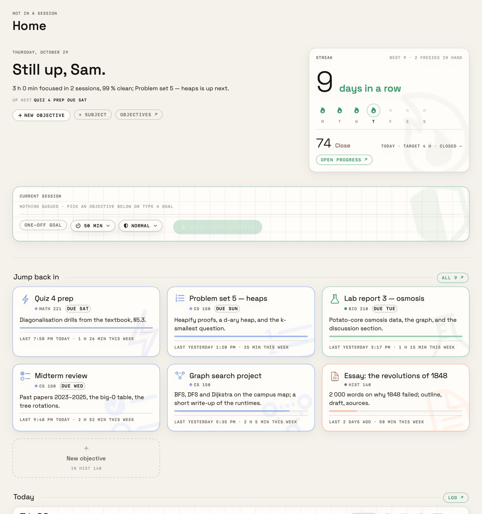
  </picture>
</p>

   

> The screenshots show an invented student, Sam, with four made-up courses. They are rendered from demo data by `scripts/readme-shots.sh`.

## Install

1. Download **`Distraction-Bot-<version>.zip`** from [Releases](../../releases) and drag **Distraction Bot** into **Applications**.
2. Open it. macOS says it can't check the app for malicious software, because it isn't notarized by Apple. Go to **System Settings → Privacy & Security**, scroll down and click **Open Anyway**.
3. In the app, **Settings → Permissions**: grant **Accessibility** and **Screen Recording**, then quit and reopen when macOS asks.
4. For the judge, install [Ollama](https://ollama.com/download) and pull a model: `ollama pull qwen3:14b` (32 GB Macs), `qwen3:8b` (16 GB) or `qwen3:4b` (8 GB).

Prefer to build it yourself? `git clone` this repo and run `scripts/install.sh`. **[INSTALL.md](INSTALL.md)** walks through both, step by step, with troubleshooting and uninstalling.

## How it works

### 1 · Plan

Courses hold objectives — a problem set, a lab report, an essay — each with a due date, an estimate and a **focus dial** from *laxed* to *extreme*. The week calendar lays your sessions over your class timetable (paste your calendar's ICS address in Settings).

<p align="center">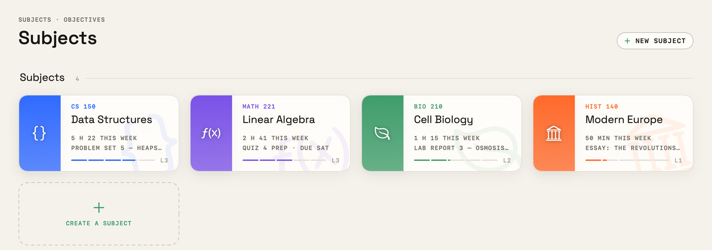</p>
<p align="center">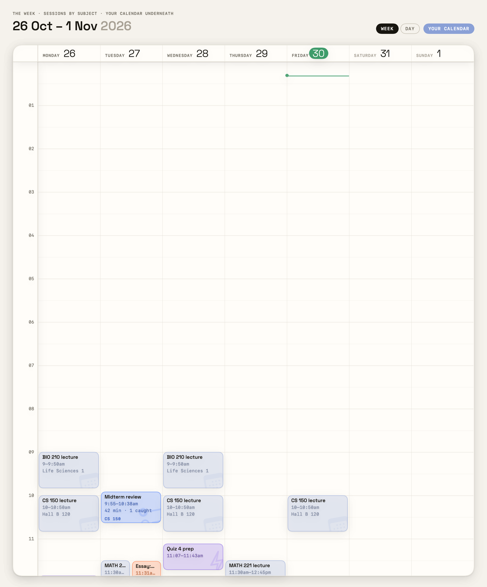</p>

### 2 · Focus

Start a session from an objective. While it runs:

- **The block list** closes, shields or warns about the apps and sites you chose. Steam closes; YouTube is judged.
- **The judge** reads the front window's title and, in Safari and Dia, the page's address, and asks the local model whether it fits your goal. A confident "no" raises a card: *Back to work*, *This is work*, or *Snooze*. "This is work" asks for how long — this once, this session, or always — so it stops asking about the same thing.
- **The look** (optional): every few minutes a small vision model describes the front window, so a PDF or a video counts by what's in it, not its title.
- **A mini panel** in a corner shows the time left and the last verdict; click it for pause, end and notes.

<p align="center">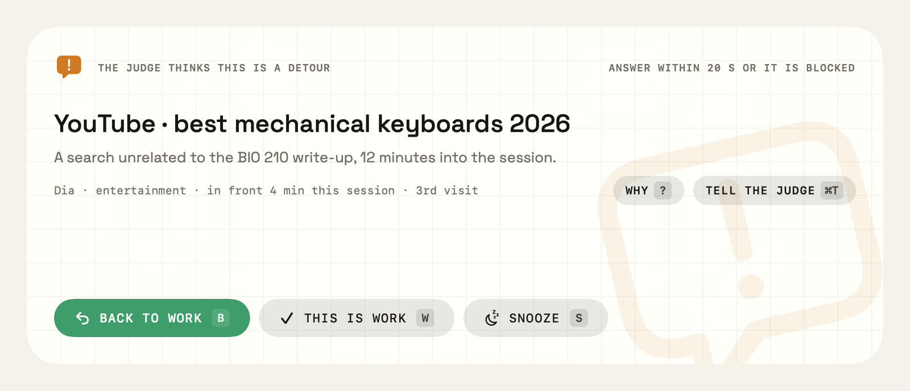</p>
<p align="center">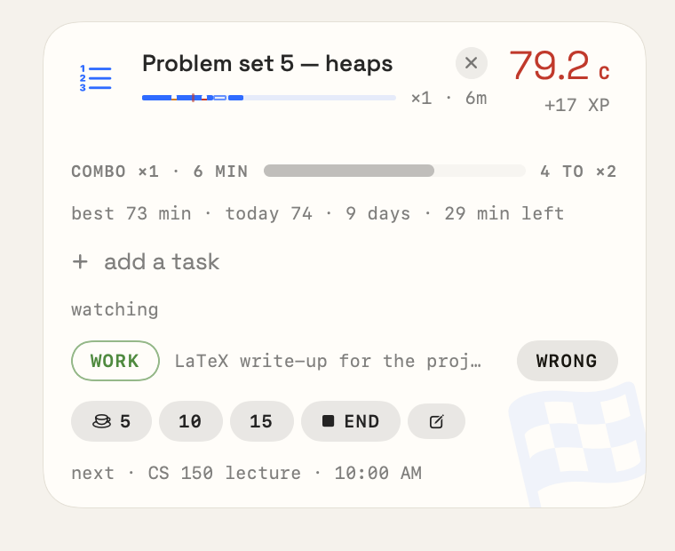&nbsp;&nbsp;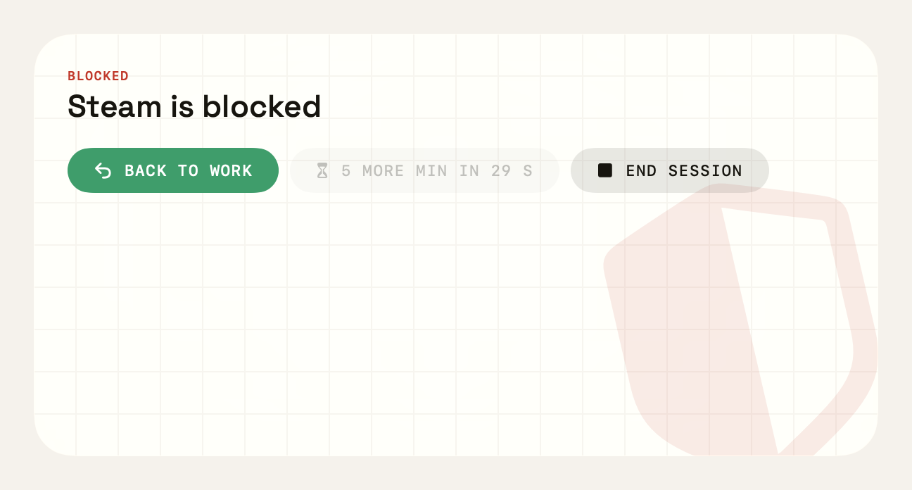</p>

**Hard** and **extreme** sessions can't be paused or quit — ⌘Q is refused, and if the app is killed a small launch agent brings it back within seconds. Ending early means typing your escape phrase.

### 3 · Reflect

When a session ends, its **accuracy** starts at 100 and takes off what each detour, miss and slip cost, settling on a grade. Then today's score counts up, the course earns its XP (with the combo you built), the tasks you ticked off are paid, and the streak's flame lights.

<p align="center">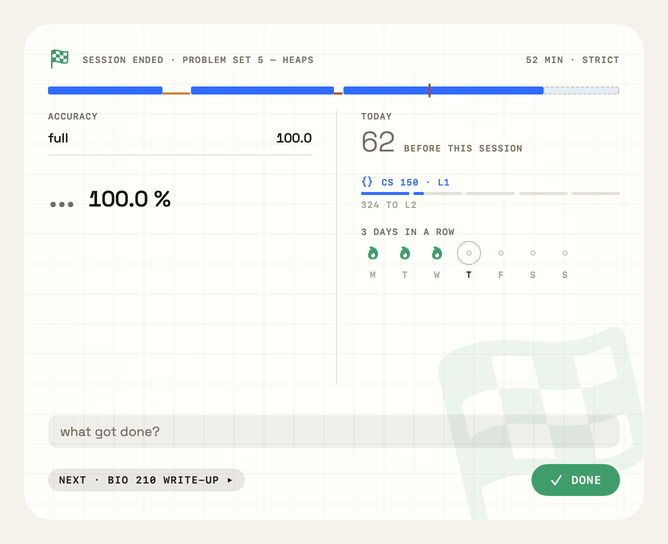</p>

Each course has its own page: its level ring, streak, this week's score with its working shown, every session with its accuracy, and when you work best. The day ends with a **shutdown** (⌘⇧D) — it can run past midnight, because a study day ends at 4 am.

<p align="center">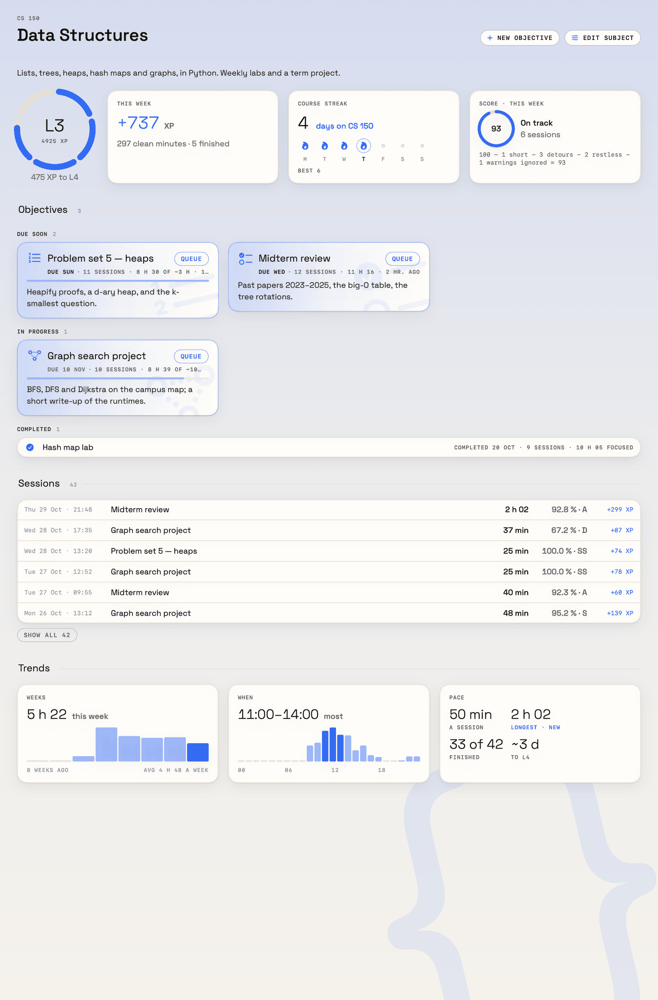</p>
<p align="center">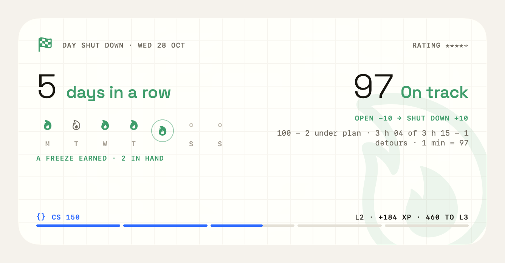</p>

## How scoring works

Every number is the same arithmetic wherever it appears: start from the full marks, take off what was lost.

**A session (out of 100)**

| Part | Points | Lost by |
|---|---|---|
| Time | 50 | focusing less than the planned length (or, for an open session, the objective's average, else 25 min). Paused and away time don't count as focused |
| Calm | 20 | 10 for the share of time spent on detours (all 10 gone at 25 %), 10 for restlessness — app switching beyond 6 in your busiest ten minutes |
| Kept | 20 | saying "back to work" and not going back. A session with no warning keeps all 20 |
| Self-control | 10 | 3 for each blocked app you tried to open |

75 and up reads **On track**, 50 and up **Close**, below that **Drifting**.

**A day (out of 100):** plan 50 (focused time against the day's plan — the one you set at the previous shutdown, or your calendar's planned blocks, else your daily target — plus 5 for each planned objective you touched, capped at 50) · calm 20 and kept 20 (the sessions' parts, weighted by time) · closed 10 (you did the shutdown).

**XP and levels, per course:** each clean minute (focused, minus detours) earns at its **combo** — ×1, ×2 once you've stayed on task 10 minutes in a row, ×3 from 30 — then × the focus dial (laxed 0.8, gentle 0.9, normal 1.0, strict 1.1, hard 1.2, extreme 1.25). A session run to its planned end adds 30, each task ticked off during it adds 10 (up to 5), and completing an objective adds 60. A course reaches **L1 at 300 XP, L2 at 1 080, L3 at 2 520, L4 at 5 400, L5 at 10 800** — roughly 3, 9, 21, 45 and 90 clean hours at a typical combo. XP is never taken away.

**Streaks:** a day counts when it has a real session (two minutes or more). Every 5 shutdowns earn a **freeze**, up to 2 in hand; a freeze bridges the first missed day.

<p align="center">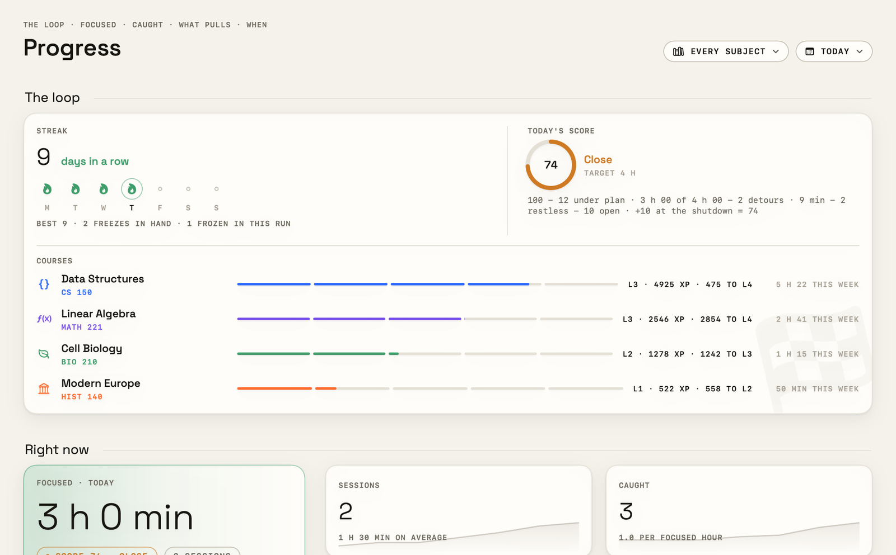</p>

## Privacy

- **Nothing leaves your Mac.** The judge and the look talk only to Ollama on `localhost:11434`. The one other connection is your calendar's ICS address, if you paste one.
- **What's read during a session:** the front app's name and window title; in Safari and Dia, the page's address; with the look on, a picture of the front window, which is described by the local vision model and then discarded — only the one-line description is kept.
- **Never read:** Messages, Mail, WhatsApp, Telegram, Discord and 1Password (the private list). They can still be blocked.
- **What's stored:** your courses, rules and settings, and a log of sessions, verdicts and answers, all in `~/Library/Application Support/Distraction Bot/`.

Details in **[PRIVACY.md](PRIVACY.md)**.

<p align="center">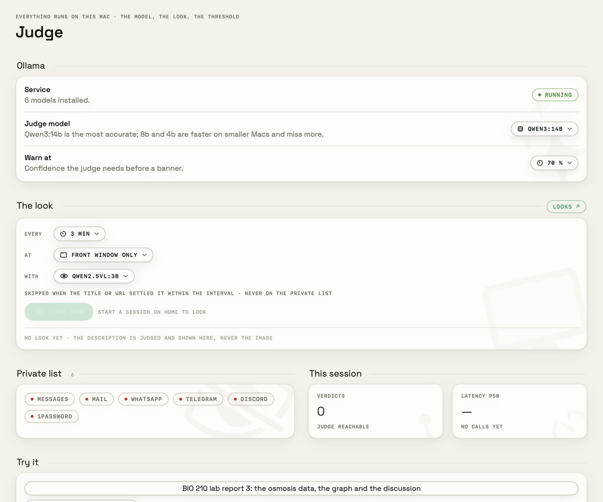</p>

## FAQ

**Why isn't it on the App Store or notarized?** Notarizing needs a paid Apple Developer account. The app is built and signed locally (ad-hoc), so macOS asks once before the first open. You can always build it yourself from this source.

**Does it work without Ollama?** Yes. The block list (close, shield, warn) works on its own; only the judge and the look need a model. The header says "ollama offline" until one is reachable.

**Which browsers?** Pages are read and judged in **Safari** and **Dia**. Other browsers are treated as apps: they can be blocked or allowed and are judged by app and window title, but their addresses aren't read.

**Can I quit a hard session?** Not with ⌘Q. Type your escape phrase (Settings → Hard mode) to end it early. If something goes wrong, `scripts/uninstall.sh` removes the relaunch agent.

**Why is Discord allowed?** It's **pinned** by default: never blocked, only budgeted, and the judge is told it's allowed. Unpin it on the Rules page.

**Intel Macs?** Not in the downloadable build. `scripts/install.sh` builds on Intel, but the local models are slow there.

## Build from source

Needs macOS 15+, the Xcode Command Line Tools (Swift 6) — no Xcode.

```bash
scripts/install.sh            # checks, builds, installs to /Applications, offers Ollama setup
scripts/bundle.sh             # just build → dist/Distraction Bot.app
scripts/make-dev-cert.sh      # once: a local signing identity so the permission grants survive rebuilds
```

| Folder | What's there |
|---|---|
| `Sources/DistractionBot/Model` | scoring, XP, the study day, the calendar parser, the log |
| `Sources/DistractionBot/Watch` | the app and browser watchers, the look |
| `Sources/DistractionBot/Judge` | the Ollama client and the prompt |
| `Sources/DistractionBot/Screens`, `Shell`, `Design` | the SwiftUI screens, the overlays, the type scale and colours |
| `scripts` | build, release, install, uninstall, the demo data and screenshots, and the `*-check.swift` tests |
| `docs/demo`, `docs/fixtures` | the demo timetable, calendar test files |

The `scripts/*-check.swift` files are self-contained tests; each one's header has its `swiftc` line. `scripts/type-lint.sh` keeps the type scale honest. The design notes that shaped the app are kept out of this repo.

## License

MIT — see [LICENSE](LICENSE). The bundled [Space Grotesk](https://github.com/floriankarsten/space-grotesk) fonts are under the SIL Open Font License 1.1. The Qwen models used through Ollama are under their own licence (Apache 2.0). Issues are welcome — see [CONTRIBUTING.md](CONTRIBUTING.md).
